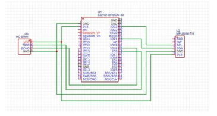
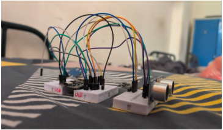
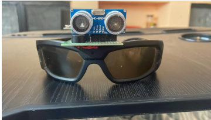
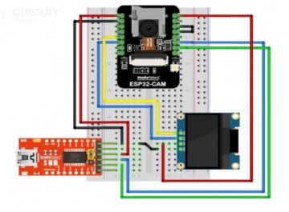
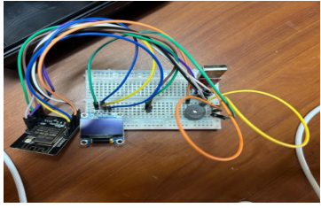
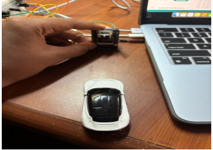
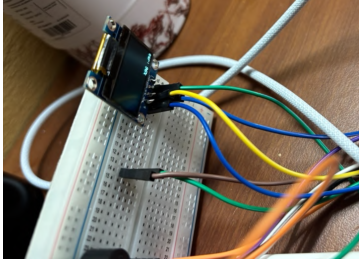
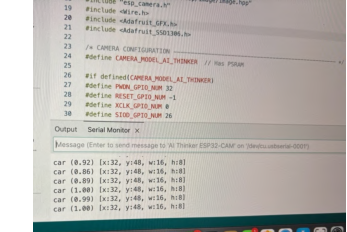

# Smart-Glasses-for-Visually-Impaired
ESP32-based assistive smart glasses combining obstacle detection, motion sensing, and camera-based object recognition.

## Overview

Smart Glasses for Assisting the Blind is an academic embedded systems project designed to support visually impaired users through obstacle detection, motion sensing, and camera-based object recognition.

The prototype combines ESP32-based sensing with an ESP32-CAM and an Edge Impulse-trained model to identify objects and provide feedback through a buzzer and OLED display.

## Key Features

- **Obstacle Detection:** Uses an ultrasonic sensor to detect nearby obstacles.
- **Motion Sensing:** Uses an MPU6050 accelerometer and gyroscope to monitor head movement.
- **Object Recognition:** Uses ESP32-CAM and an Edge Impulse model to recognize trained object classes.
- **Visual Feedback:** Displays detection labels and confidence percentages on an OLED screen.
- **Audio Alerts:** Activates a buzzer when an object is detected.

## Hardware Components

| Component | Purpose |
|---|---|
| ESP32 | Sensor processing and obstacle alerts |
| ESP32-CAM (AI-Thinker) | Image capture and object detection |
| Ultrasonic sensor (HC-SR04) | Distance-based obstacle detection |
| MPU6050 | Motion sensing |
| SSD1306 OLED (128 × 64) | Displays detection results |
| Active buzzer | Audio alerts |

## Software and Technologies

- Embedded C/C++ with Arduino IDE
- Edge Impulse for machine-learning inference
- ESP32 camera driver
- Adafruit GFX and SSD1306 libraries

## Repository Structure

- `src/` — ESP32-CAM firmware
- `images/` — Circuit diagrams, hardware photographs, and output screenshots
- `docs/` — Project report
- `libraries/` — Dependency and installation instructions

## Project Gallery

### 1. ESP32 Circuit Diagram

### 2. Breadboard Circuit

### 3. Implemented Hardware

### 4. ESP32-CAM Circuit Diagram

### 5. Circuit Breadboard Setup

### 6. Hardware Implementation

### 7. Object Detection — OLED Output

### 8. Object Detection — Serial Monitor

## Technologies Used
- ESP32 and ESP32-CAM
- Ultrasonic sensor (HC-SR04)
- MPU6050 accelerometer and gyroscope
- OLED display and buzzer
- Edge Impulse for object detection
- Embedded C/C++ and hardware integration

## Limitations and Safety

This is an academic prototype. Object detection performance depends on the trained model, lighting, camera positioning, and hardware constraints. The system should not be used as a person's sole mobility aid or as a substitute for a white cane, guide dog, or other established mobility support.

## Team Members

- Damini Katakam
- Karthik Selvaraj
- Narisipuram Tejus Kumar

## Disclaimer
This is an academic prototype. It is not a substitute for a white cane, guide dog, or other established mobility aids.
